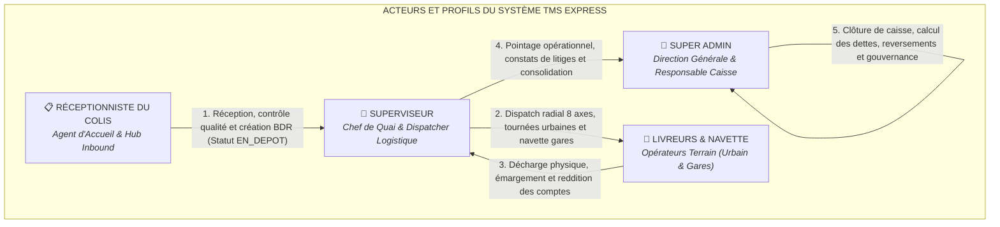
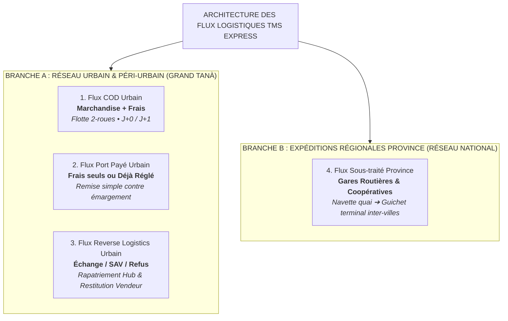
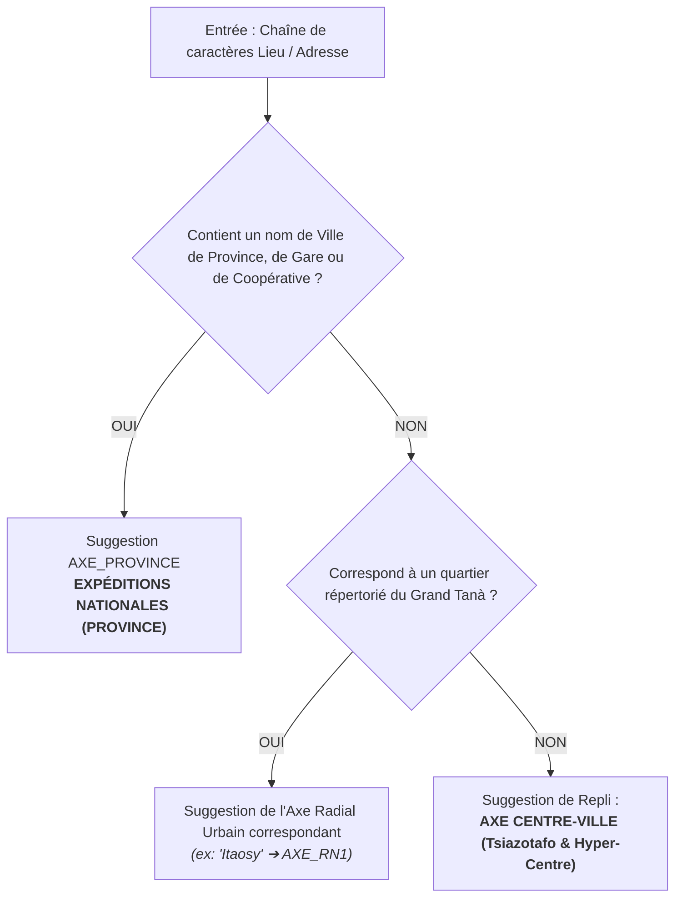
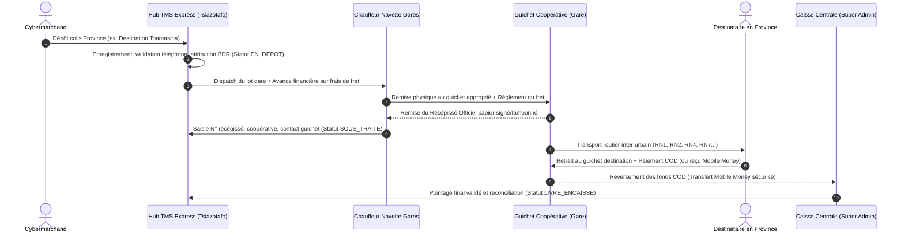
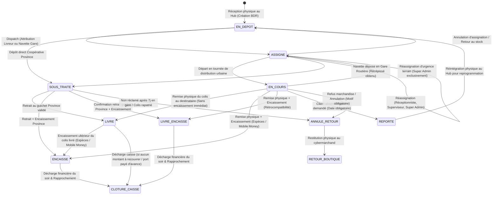
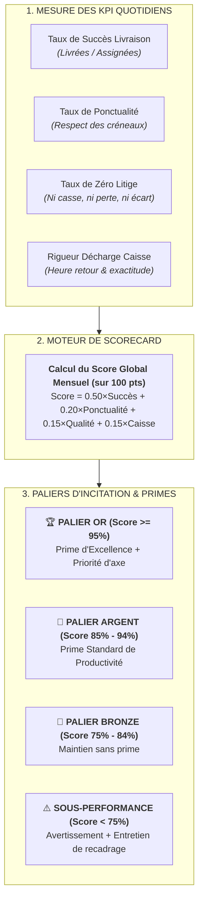
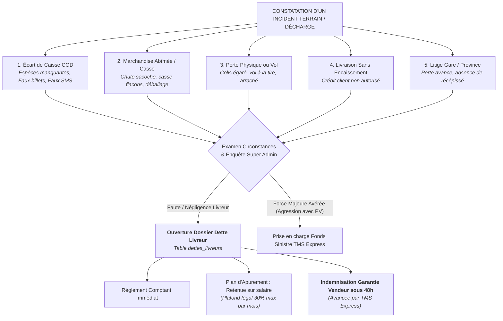
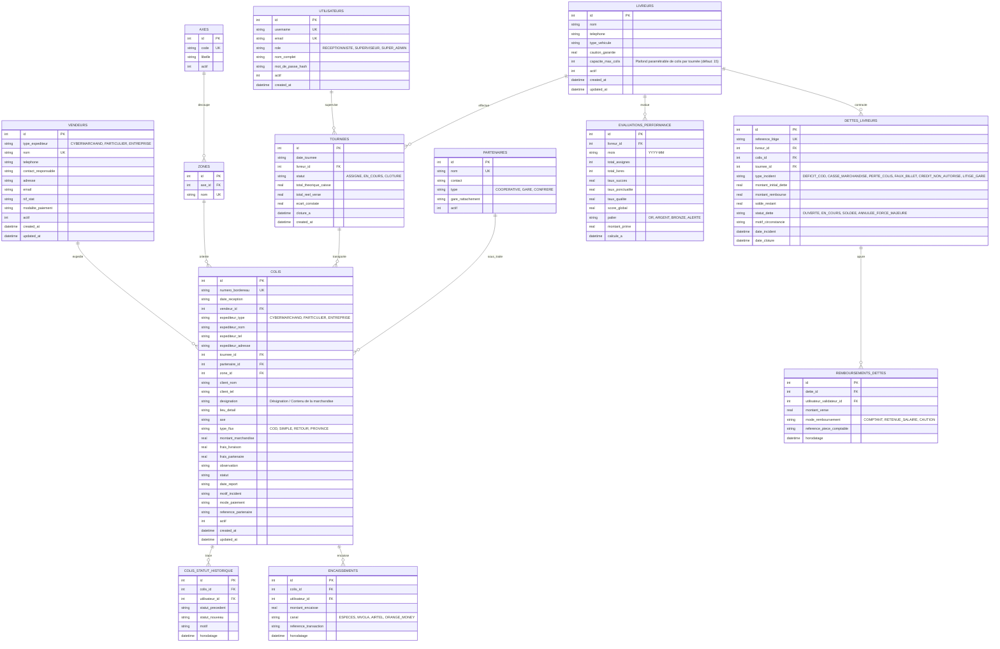

# 📘 CAHIER DES CHARGES TECHNIQUE ET FONCTIONNEL
## APPLICATION DE GESTION DU TRANSPORT DU DERNIER KILOMÈTRE, DES EXPÉDITIONS RÉGIONALES ET DU PILOTAGE DES COURSIERS (TMS EXPRESS)
**Version :** 5.0.0 • **Statut :** Spécification Métier, Financière et Technique de Référence Absolue • **Type d'Application :** Logiciel Web Métier Autonome (Desktop & Mobile Responsive PWA)

---

## 1. FICHE SIGNALÉTIQUE ET CONTEXTE DU PROJET

| Attribut | Spécification Détaillée |
| :--- | :--- |
| **Nom du Logiciel** | **TMS EXPRESS** (Transport Management System Express) |
| **Périmètre Applicatif** | Application Web d'Entreprise dédiée à la logistique urbaine du dernier kilomètre (*Last-Mile Delivery*), aux expéditions régionales en Province (*Inter-City Freight*), au management de la performance des livreurs et à la gestion stricte du recouvrement financier et des litiges |
| **Zone Géographique d'Exploitation** | **Séparation Stricte en 2 Branches Réseau Complètement Distinctes :** • **Branche A - Réseau Urbain & Péri-urbain (Grand Tanà) :** Antananarivo Renivohitra et communes périphériques (rayon de 25 km, 7 corridors logistiques radiaux urbains), tournées quotidiennes en deux-roues 110cc à 150cc, livraisons J+0 / J+1, encaissement direct COD. • **Branche B - Expéditions Régionales en Province (Réseau National Inter-villes) :** Tout Madagascar via les 3 gares routières d'Antananarivo (Ambodivona pour l'Est, Fasan'ny Karana pour le Sud, Andohatapenaka pour l'Ouest et le Nord) et les coopératives nationales (RN1, RN2, RN3, RN4, RN6, RN7) ; transit assuré par navette fourgonnette dédiée, formalisation par récépissé officiel de transport, avance de trésorerie sur frais de fret partenaire, retrait final par le destinataire au guichet terminal de la coopérative sous délai de garde maximal de 7 jours. |
| **Modèle Économique & Cible** | Prestation logistique multi-donneurs d'ordre couvrant : 1. **Cybermarchands** (*E-commerce, boutiques réseaux sociaux, distributeurs*) avec encaissement contre-remboursement (COD) et reversement garanti. 2. **Particuliers** (*Envois C2C ponctuels de colis, cadeaux, effets personnels, documents urgents, ventes occasionnelles*). 3. **Entreprises & B2B** (*Sociétés, PME, administrations, professions libérales : plis confidentiels, factures, contrats, pièces détachées, échantillons industriels*). |
| **Type d'Architecture** | **Application Web d'Entreprise Autonome (Zéro Dépendance Tableur) :**  • Frontend : Interface Web Responsive & Progressive Web App (HTML5, TailwindCSS, Composants Réactifs, Vue Mobile optimisée coursiers) • Backend : API RESTful (Python 3.12+ / FastAPI), Architecture en couches (*Domain / Service / Repository*) • Base de Données : SGBD Relationnel normalisé 3NF (PostgreSQL / SQLite transactionnel ACID) |
| **Devise Opérationnelle** | Ariary Malgache (**MGA / Ar**) • Gestion stricte des montants entiers positifs sans décimales |
| **Fuseau Horaire Obligatoire** | **GMT+3 (Indian/Antananarivo)** sur l'intégralité des modules, calculs, journaux d'audit et horodatages |

---

## 2. GLOSSAIRE MÉTIER ET TECHNIQUE

*   **BDR (Bordereau de Livraison) :** Numéro d'immatriculation alphanumérique unique généré automatiquement pour chaque colis (format séquentiel strict à 4 chiffres : `0001`, `0002`... ou horodaté `BDR-YYYY-XXXX`).
*   **Donneur d'Ordre / Expéditeur :** Entité ou individu émetteur du colis confié à TMS EXPRESS. Il se décline en 3 typologies distinctes :
    1.  **CYBERMARCHAND** : Boutique e-commerce, vendeur sur réseaux sociaux (Facebook, Instagram, TikTok) ou marketplace, opérant avec encaissement COD et reversements réguliers.
    2.  **PARTICULIER** : Client individuel effectuant un envoi ponctuel de point à point (cadeau, effets personnels, document, vente d'occasion entre particuliers).
    3.  **ENTREPRISE** : Personne morale, PME, grande société ou administration ayant des flux récurrents ou volumineux B2B/B2C (contrats, pièces, factures, échantillons), avec règlement au comptant ou en compte entreprise facturé périodiquement.
*   **Contacts Expéditeur (Données Obligatoires Inbound) :** Pour tout colis enregistré, le système collecte obligatoirement : le type d'expéditeur (`CYBERMARCHAND`, `PARTICULIER`, `ENTREPRISE`), le nom ou raison sociale, le numéro de téléphone certifié au format malgache (10 chiffres avec identification Telma, Orange ou Airtel), l'adresse ou quartier de ramassage/siège, et le contact référent / email (optionnel).
*   **Désignation de la Marchandise / Colis :** Description textuelle précise de la marchandise transportée (ex: *Robe soyeuse, Smartphone, Pièces détachées, Dossier juridique, Cosmétiques*). Elle est obligatoire ou fortement recommandée pour le contrôle visuel à l'Inbound, la clarté lors de la remise au destinataire et le traitement transparent des litiges éventuels.
*   **COD (Cash On Delivery / Contre-Remboursement) :** Processus dans lequel le livreur ou le guichet de retrait encaisse auprès du destinataire la valeur marchande du colis au moment de la remise, en plus des frais de transport.
*   **Course Simple / Port Payé :** Livraison dont la valeur marchande est déjà réglée d'avance par l'acheteur au cybermarchand ; le transporteur ne perçoit que les frais de service (ou aucun montant si les frais font l'objet d'un contrat de facturation périodique).
*   **Axe Logistique :** Corridor de transport délimitant un secteur géographique déterminé à partir du Hub Central de Tsiazotafo pour organiser rationnellement les tournées.
*   **Hub Central (Tsiazotafo) :** Dépôt central unique situé à Tsiazotafo / Analakely (Antananarivo) où s'opèrent la réception physique (Inbound), le contrôle qualité, le tri, le dispatching matinal, la décharge de tournée et la clôture financière du soir.
*   **Gare Routière :** Station terminale inter-urbaine d'Antananarivo (Ambodivona pour l'Est, Fasan'ny Karana pour le Sud, Andohatapenaka pour l'Ouest et le Nord) d'où partent les véhicules de transport national.
*   **Coopérative de Transport National :** Société ou coopérative de transport de voyageurs et de fret (ex: Cotisse, Kofmad, Besady, Trans Texpress, Sonatra) prenant en charge l'acheminement routier du colis entre Antananarivo et la ville de Province de destination.
*   **Récépissé de Transport :** Titre officiel délivré par la coopérative lors du dépôt du colis en gare routière, comportant le numéro de suivi partenaire (`reference_partenaire`), le montant des frais de fret payés (`frais_partenaire`) et les contacts du guichet de destination.
*   **Scorecard Livreur :** Tableau d'évaluation multidimensionnel calculant la note de performance opérationnelle d'un coursier sur la base de ses livraisons réussies, de sa ponctualité, de son taux de litige et de sa rigueur de caisse.
*   **Dette Livreur :** Créance financière exigible inscrite au passif du compte personnel d'un livreur suite à un déficit d'encaissement COD, une perte de marchandise, une casse avérée ou un non-respect des procédures obligatoires.
*   **Décharge de Tournée / Clôture de Caisse :** Processus comptable de fin de journée consistant à réconcilier l'argent physique perçu (Espèces, Mobile Money) avec le total théorique attendu et les pièces justificatives des dépenses engagées.

---

## 3. PROFILS UTILISATEURS, ACTEURS & MATRICE DES DROITS (RBAC & RACI)

L'application repose sur un cloisonnement rigoureux des rôles et des responsabilités opérationnelles :

### 3.1 Profil 1 : Le Réceptionniste du Colis (Agent d'Accueil & Hub Inbound)
*   **Mission Principale :** Assurer la prise en charge physique et numérique de tout colis entrant dans le réseau TMS Express (déposé au Hub Central de Tsiazotafo par les cybermarchands ou collecté par les équipes de ramassage).
*   **Responsabilités Opérationnelles :**
    1.  **Contrôle Qualité Physique Inbound :** Examen visuel de l'emballage (intégrité, étanchéité, résistance), vérification du gabarit et pesée. Si l'emballage présente une fragilité préexistante, mention obligatoire d'une réserve écrite signée par l'expéditeur, sous peine d'endosser la responsabilité d'une casse ultérieure.
    2.  **Enregistrement Numérique Instantané :** Saisie des données via l'écran d'enregistrement multi-colis par lot ou par validation de fichiers d'importation (Excel / CSV) fournis par les cybermarchands.
    3.  **Validation Stricte des Données de Contact :** Vérification obligatoire du numéro de téléphone du destinataire (format malgache exact à 10 chiffres débutant par `03`, avec identification automatique de l'opérateur Telma, Orange ou Airtel).
    4.  **Immatriculation & Attribution BDR :** Génération et assignation du numéro de bordereau unique et inviolable.
    5.  **Affectation au Magasin de Transit :** Enregistrement initial sous le statut système **`EN_DEPOT`**.
    6.  **Édition des Étiquettes d'Identification :** Impression immédiate de l'étiquette de transport comportant le numéro BDR, le destinataire, l'axe logistique et le montant total à encaisser.
*   **Habilitations & Restrictions :**
    *   *Autorisé :* Création de colis, consultation du registre du jour, recherche dans l'annuaire des expéditeurs, impression des étiquettes d'accueil, **assignation et réassignation de colis vers un livreur / tournée UNIQUEMENT si le colis n'est pas déjà en cours de livraison (`EN_DEPOT`, `ASSIGNE`, `REPORTE`).**
    *   *Strictement Interdit :* Suppression de colis, modification des montants financiers après validation, **réassignation d'un colis déjà au statut `EN_COURS` (prérogative exclusive réservée au Super Admin)**, pointage des statuts de livraison, validation des encaissements de caisse, imputation de dettes ou modification du paramétrage des axes.

### 3.2 Profil 2 : Le Superviseur (Superviseur Logistique & Dispatcher)
*   **Mission Principale :** Piloter l'activité logistique quotidienne du quai, orchestrer le dispatching des tournées de livraison, évaluer en direct la productivité des coursiers et superviser l'exécution terrain en temps réel.
*   **Responsabilités Opérationnelles :**
    1.  **Arbitrage du Dispatching :** Examen matinal des colis en stock (`EN_DEPOT`), validation de l'axe logistique détecté et constitution des tournées de livraison par affectation en masse aux livreurs titulaires.
    2.  **Organisation des Expéditions en Province :** Regroupement de tous les envois destinés aux villes régionales selon leur gare routière de correspondance (Ambodivona, Fasan'ny Karana, Andohatapenaka) et affectation au coursier navette dédié.
    3.  **Édition des Feuilles de Route :** Génération des bordereaux de tournée papier pour émargement (format ticket thermique 80 mm ou A4) et export de la synthèse textuelle pour notification mobile via WhatsApp.
    4.  **Pilotage en Temps Réel & Scorecards :** Suivi continu des indicateurs opérationnels sur le Tableau de Bord (progression des tournées, colis restants, alertes retards, taux de succès instantané de chaque livreur).
    5.  **Pointage Opérationnel :** Qualification du résultat des tournées :
        *   Passage en `LIVRE_ENCAISSE` dès confirmation de remise et encaissement.
        *   Passage en `REPORTE` avec **obligation de renseigner une date de reprogrammation valide** (`YYYY-MM-DD`).
        *   Passage en `ANNULE_RETOUR` avec **obligation de motiver l'incident** (refus client, article non conforme, annulation).
        *   Passage en `SOUS_TRAITE` dès confirmation de dépôt en gare routière.
    6.  **Gestion des Retours Quai & Constat de Litige :** Réception physique des colis non livrés (reportés ou refusés) et réintégration dans le casier de stockage du Hub. En cas de colis retourné écrasé ou ouvert, rédaction d'un **Procès-Verbal de Constat d'Avarie** contradictoire avec le livreur.
*   **Habilitations & Restrictions :**
    *   *Autorisé :* Lecture de tous les colis, modification de l'assignation des tournées, exécution du pointage, modification opérationnelle (correction d'adresse ou de téléphone destinataire), consultation des KPIs de productivité et scorecards livreurs.
    *   *Strictement Interdit :* Clôture définitive de la caisse centrale, modification des grilles tarifaires contractuelles des cybermarchands, validation unilatérale d'abandon de créance ou suppression définitive d'enregistrements en base de données.

### 3.3 Profil 3 : Le Super Admin (Direction Générale, Responsable Caisse & Administrateur Système)
*   **Mission Principale :** Assurer la direction financière et stratégique du réseau de transport, superviser la trésorerie globale, valider les reversements aux cybermarchands, arbitrer les litiges financiers, gérer le recouvrement des dettes livreurs et administrer le système d'information.
*   **Responsabilités Opérationnelles :**
    1.  **Contrôle de Caisse Centrale & Encaissement COD :** Validation de l'encaissement effectif des fonds collectés lors des tournées urbaines ou reversés par les coopératives de Province.
    2.  **Clôture Comptable Quotidienne :** Réconciliation financière de chaque livreur à la fin de sa journée de travail en appliquant la formule d'équilibre strict : $\text{Espèces Remises} + \text{Preuves Mobile Money} + \text{Récépissés Frais Gares} = \text{Total Théorique Dû}$.
    3.  **Arbitrage des Litiges & Création des Dossiers de Dette :** En cas d'écart de caisse inexpliqué, de perte de marchandise ou de casse constatée, ouverture officielle d'un dossier dans le registre des litiges (`dettes_livreurs`) et détermination de la quote-part imputable.
    4.  **Mise en Place des Plans d'Apurement des Dettes :** Définition de l'échéancier de remboursement (retenue sur salaire/commissions dans le respect des plafonds légaux ou paiement comptant).
    5.  **Indemnisation Garantie des Cybermarchands :** Déclenchement de l'indemnisation financière du vendeur sous 48h ouvrées, indépendamment du délai de remboursement du livreur fautif.
    6.  **Rapprochement & Reversement Cybermarchands :** Calcul automatique et validation des états de reversement financier aux vendeurs partenaires (Montant total des marchandises encaissées déduction faite des frais de livraison et commissions convenues).
    7.  **Administration du Référentiel Logistique :** Création, mise à jour ou désactivation des axes logistiques, des zones de distribution, des tarifs de base, des barèmes de primes et du registre des coopératives.
*   **Habilitations :**
    *   *Droits Absolus (Super-Privilège) :* Accès complet en lecture, écriture, modification, suppression logique (`Soft Delete`), paramétrage global, imputation/annulation de dettes, validation financière irréversible, et **droit exclusif de forçage pour la réassignation d'un colis déjà en cours (`EN_COURS`)** vers un autre coursier ou navette en cas d'urgence opérationnelle.

---

### 3.4 Matrice RBAC des Droits Applicatifs (Role-Based Access Control)

| Fonctionnalité / Écran Système | Réceptionniste | Superviseur | Super Admin | Livreur / Navette |
| :--- | :---: | :---: | :---: | :---: |
| **Création Colis (Formulaire par Lot)** | **Création / Saisie** | Création / Saisie | Création / Saisie | Lecture seule (Bordereau) |
| **Importation Massive (Fichiers Entreprise)** | **Exécution** | **Exécution** | **Exécution** | Aucun accès |
| **Dispatching & Assignation des Tournées** | **Assignation / Réassignation (colis hors EN_COURS)** | **Opérateur Maître (colis hors EN_COURS)** | **Supervision Totale & Forçage (y compris colis EN_COURS)** | Consultation de sa tournée |
| **Édition Feuilles de Route & Tickets 80 mm** | Aucun accès | **Édition & Export** | **Édition & Export** | Réceptionnaire |
| **Pointage des Livraisons en Direct** | Aucun accès | **Validation Opérationnelle** | **Contrôle & Forçage** | Déclaration terrain |
| **Cockpit & Barres de Progression (KPIs)** | Lecture synthèse | **Pilotage Quotidien** | **Pilotage Stratégique** | Aucun accès |
| **Validation Encaissements COD** | Aucun accès | Aucun accès | **Validation Exclusif** | Remise des fonds |
| **Clôture Journalière de Caisse** | Aucun accès | Aucun accès | **Clôture Exclusif** | Émargement décharge |
| **Suivi Performance & Scorecard Livreurs** | Aucun accès | **Consultation & Suivi**| **Arbitrage & Primes** | Consultation note perso |
| **Gestion des Dettes & Litiges Livreurs** | Déclaration constat | Constat & Rapport PV | **Gestion & Recouvrement**| Consultation solde dû |
| **Reversement Financier aux Cybermarchands** | Aucun accès | Aucun accès | **Ordonnancement Exclusif**| Aucun accès |
| **Gestion du Référentiel (Axes & Gares)** | Aucun accès | Consultation | **Administration Totale** | Aucun accès |
| **Sous-traitance Province (Dépôt Gare)** | Enregistrement | **Assignation Navette** | **Validation Fret/COD** | Dépôt physique guichet |

---

### 3.5 Matrice de Responsabilité Opérationnelle RACI

*Légende : **R** = Réalisateur (Responsible) • **A** = Approbateur / Décideur Final (Accountable) • **C** = Consulté (Consulted) • **I** = Informé (Informed)*

| Processus Opérationnel Clé | Réceptionniste | Superviseur | Super Admin | Livreur / Navette |
| :--- | :---: | :---: | :---: | :---: |
| Réception physique et contrôle qualité au Hub | **R** | **A** | I | I |
| Saisie, validation téléphone malgache et création BDR | **R** | A | I | I |
| Tri géographique et validation de l'axe logistique | C | **R / A** | I | I |
| Constitution et assignation initiale des tournées | **R** | **R / A** | I | C |
| Réassignation de colis hors départ terrain (`EN_DEPOT`, `ASSIGNE`) | **R** | **R / A** | I | C |
| Réassignation d'urgence d'un colis déjà en cours (`EN_COURS`) | *Interdit* | *Interdit* | **R / A (Exclusif)** | I |
| Regroupement et assignation des colis Province (Gares) | I | **R / A** | I | C |
| Acheminement navette et dépôt au guichet coopérative | I | A | C | **R** |
| Saisie du numéro de récépissé et frais de fret gare | I | **R** | A | C |
| Pointage des statuts de livraison en temps réel | I | **R** | A | C |
| Constat contradictoire d'avarie / colis abîmé | C | **R** | **A** | C |
| Remise physique des fonds encaissés (Espèces/Mobile Money)| I | C | **A** | **R** |
| Rapprochement financier du soir & détection écart caisse | I | C | **R / A** | I |
| Ouverture d'un dossier de dette livreur et plan d'apurement | I | C | **R / A** | I |
| Indemnisation directe garantie du cybermarchand | I | I | **R / A** | I |
| Calcul mensuel du score de performance et des primes | I | C | **R / A** | I |
| Rapprochement des comptes et reversement cybermarchands | I | I | **R / A** | I |

---

## 4. PÉRIMÈTRE MÉTIER & SÉPARATION DES FLUX LOGISTIQUES (URBAIN VS PROVINCE)

L'organisation logistique de TMS Express est strictement scindée en **deux branches opérationnelles étanches** répondant à des contraintes de transport, des moyens roulants, des modes d'encaissement et des responsabilités juridiques fondamentalement distincts :

### 4.1 Branche A : Flux Logistiques Urbains & Péri-urbains (Flotte Directe Deux-Roues)

Ces flux concernent l'intégralité des livraisons exécutées directement par les coursiers salariés ou prestataires de TMS Express au guidon de scooters et motos sur le Grand Tanà (rayon de 25 km autour du Hub Central de Tsiazotafo).

#### Flux 1 : Livraison COD Urbaine (Contre-Remboursement - *Cœur de Métier*)
*   **Définition :** Commande e-commerce où le destinataire final s'acquitte du montant de la marchandise et/ou des frais de livraison au moment précis de la remise physique en main propre.
*   **Paramètres Financiers :** Montant Marchandise $> 0\text{ Ar}$ • Frais de Livraison $> 0\text{ Ar}$ (ou offerts par le vendeur).
*   **Formule du Montant Total :**
    $$\text{Total à Encaisser} = \text{Montant Marchandise} + \text{Frais de Livraison}$$
*   **Règlement Destinataire :** Espèces en main propre ou transfert instantané Mobile Money (MVola, Airtel Money, Orange Money) validé sur le champ au coursier.
*   **Obligation Comptable :** Double réconciliation journalière lors de la clôture de caisse du soir : encaissement sur le compte central de TMS Express puis reversement au cybermarchand sous 48h ouvrées.

#### Flux 2 : Course Simple Urbaine (Port Payé / Valeur Marchande Prépayée)
*   **Définition :** Envoi dont la marchandise a été préalablement acquittée par l'acheteur au cybermarchand (par virement bancaire, chèque ou Mobile Money distant).
*   **Paramètres Financiers :** Montant Marchandise $= 0\text{ Ar}$ • Frais de Livraison $\ge 0\text{ Ar}$.
*   **Dénouement :** Si les frais de livraison sont à la charge de l'acheteur, le livreur encaisse uniquement les frais. Si les frais sont pris en charge par le cybermarchand (forfait mensuel ou prépayé), le livreur effectue une simple remise contre émargement client sans encaissement (`total_to_collect = 0 Ar`).

#### Flux 3 : Reverse Logistics Urbain (Retours Marchandises & SAV)
*   **Définition :** Prise en charge des colis non remis pour cause de refus client (défaut constaté, déconvenue, délai dépassé) ou dans le cadre d'un échange standard d'article (erreur de taille, pointure, modèle).
*   **Règles de Gestion :**
    *   Tout refus constaté sur le terrain bascule obligatoirement le colis au statut **`ANNULE_RETOUR`** avec saisie impérative du motif d'échec.
    *   Le coursier réintègre le colis intact au Hub Central de Tsiazotafo lors de la décharge quai du soir.
    *   Le réceptionniste le prend en charge en zone de retour sécurisée et édite le bon de restitution au cybermarchand contre signature d'émargement.

---

### 4.2 Branche B : Flux Logistique Province (Expéditions Nationales Sous-Traitées)

Ce flux, totalement isolé du réseau urbain, traite les envois destinés aux localités et provinces malgaches situées au-delà du rayon d'action de la flotte urbaine.

#### Flux 4 : Expéditions Régionales en Province (Gares Routières & Coopératives Régionales)
*   **Définition :** Acheminement inter-villes confié aux coopératives de transport national partenaires au départ des 3 gares routières d'Antananarivo (Ambodivona, Fasan'ny Karana, Andohatapenaka).
*   **Caractéristiques Structurelles Distinctives :**
    1.  **Moyen de Transport Dédié :** Acheminement quai assuré par une **fourgonnette navette transit** (et non par des deux-roues individuels) effectuant le ramassage matinal au Hub et le dépôt groupé aux guichets des gares routières.
    2.  **Double Composante Financière :** Frais de service TMS Express (Hub + acheminement gare) cumulés aux frais de fret réclamés par la coopérative (`frais_partenaire`), avancés en trésorerie au chauffeur navette.
    3.  **Titre Officiel de Transport Obligatoire :** Tout dépôt donne lieu à la remise d'un récépissé papier physique tamponné comportant la référence officielle (`reference_partenaire`) et le contact du guichet de destination.
    4.  **Retrait au Guichet Terminal sous 7 Jours :** La délivrance finale ne s'effectue pas à domicile mais au guichet de la coopérative de la ville de destination, sous un délai de garde contractuel maximal de **7 jours calendaires**.

---

## 5. RÉFÉRENTIEL GÉOGRAPHIQUE & SÉLECTION DE L'AXE LOGISTIQUE (URBAIN VS PROVINCE)

Toute l'organisation du tri et du dispatching gravite autour du **Hub Central Unique de Tsiazotafo / Analakely**. Le maillage territorial se compose de **7 corridors urbains radiaux** et d'**1 axe dédié aux expéditions nationales** :

| N° | Code Système | Dénomination Officielle de l'Axe | Réseau & Villes / Quartiers Couverts | Moyen de Transport |
| :-: | :--- | :--- | :--- | :--- |
| **1** | **`AXE_CENTRE`** | **AXE CENTRE-VILLE (Tsiazotafo & Hyper-Centre)** | **Réseau Urbain :** Analakely, Antaninarenina, Isoraka, Tsaralalàna, Behoririka, Mahamasina, Faravohitra, Ambohijatovo, Antsahabe | Scooter 110cc |
| **2** | **`AXE_RN1`** | **AXE RN1 OUEST (Tsiazotafo ➔ Itaosy / Ampitatafika)** | **Réseau Urbain :** 67Ha, Ampefiloha, Anosizato, Ambodin'isotry, Itaosy, Cité Seimad, Ampitatafika, Fenoarivo | Scooter 125cc |
| **3** | **`AXE_RN2`** | **AXE RN2 EST (Tsiazotafo ➔ Ambohimangakely)** | **Réseau Urbain :** Besarety, Mahavoky, Avaradoha, Ampasapito, Nanisana, Ankadindramamy, Mahazo, Ambohimahitsy, Ambohimangakely | Scooter 125cc |
| **4** | **`AXE_RN3`** | **AXE RN3 NORD (Tsiazotafo ➔ Sabotsy Namehana)** | **Réseau Urbain :** Andravoahangy, Ambodivona (secteur urbain), Manjakaray, Anjanahary, Amboditsiry, Analamahitsy, Ilafy, Sabotsy Namehana | Moto Trail 150cc |
| **5** | **`AXE_RN4`** | **AXE RN4 / DIGUE (Tsiazotafo ➔ Ivato Aéroport)** | **Réseau Urbain :** Antanimena, Ankorondrano, Andraharo Zone Galaxy, Alarobia, Ambohimanarina, Ambohibao, Talatamaty, Mandrosoa, Ivato | Moto Cross 150cc |
| **6** | **`AXE_RN7`** | **AXE RN7 SUD (Tsiazotafo ➔ Iavoloha / Andoharanofotsy)** | **Réseau Urbain :** Ankadimbahoaka, Tanjombato, Andoharanofotsy, Iavoloha, Ambohimanambola | Scooter 150cc |
| **7** | **`AXE_SUD_EST`** | **AXE SUD-EST (Tsiazotafo ➔ Ankatso / Alasora)** | **Réseau Urbain :** Ambanidia, Mandroseza, Ankatso (Campus Universitaire), Tsiadana, Ambatoroka, Befelatanana, Alasora, By-Pass Sud | Moto Roadster |
| **8** | **`AXE_PROVINCE`**| **AXE PROVINCES & GARES ROUTIÈRES (Coopératives)** | **Réseau National (Provinces) :** Gares Ambodivona, Fasan'ny Karana, Andohatapenaka. Villes : Toamasina, Majunga, Antsirabe, Fianarantsoa, Toliara, Diego, Moramanga, Sambava, etc. | Fourgonnette Navette Transit |

### 5.1 Algorithme d'Assistance à la Détection des Axes (Suggestion Non Bloquante)
Lors de la saisie de l'adresse ou du lieu, l'application propose une pré-sélection d'axe automatique à titre purement indicatif :

1.  **Niveau 1 (Mots-clés Province prioritaires) :** Détecte les villes de province (*Toamasina, Mahajanga, Antsirabe, Fianarantsoa, Toliara, Diego, Sambava, etc.*), gares routières (*Ambodivona, Fasan'ny Karana, Maki, Andohatapenaka*) ou coopératives (*Cotisse, Kofmad, Besady, Sonatra*).
2.  **Niveau 2 (Corridors Urbains) :** Détecte les quartiers du Grand Tanà rattachés aux axes 1 à 7.
3.  **Niveau 3 (Repli par défaut) :** Affecte temporairement `AXE_CENTRE` si l'adresse est imprécise.

### 5.2 RÈGLE FONDAMENTALE : SÉLECTION MANUELLE ET MODIFIABLE DE L'AXE

> [!IMPORTANT]
> **La sélection de l'axe logistique est 100% MANUELLE et LIBREMENT MODIFIABLE à tout moment par l'opérateur.** L'algorithme d'auto-détection n'est qu'un assistant d'aide à la saisie. En aucun cas le système ne contraint ni ne verrouille le choix de l'axe.

#### 1. Liberté Totale de Sélection à l'Inbound (Écran 01)
*   Sur le formulaire de réception par lot ou unitaire, l'opérateur dispose d'un sélecteur déroulant interactif (`data-cy="select-axis-${idx}"`) présentant deux groupes d'options formellement cloisonnés :
    *   **🛵 Réseau Urbain (Grand Tanà) :** Axes 1 à 7 (`AXE_CENTRE`, `AXE_RN1`, `AXE_RN2`, `AXE_RN3`, `AXE_RN4`, `AXE_RN7`, `AXE_SUD_EST`).
    *   **🚐 Expéditions Nationales (Province) :** Axe 8 (`AXE_PROVINCE`).
*   L'opérateur peut sélectionner manuellement l'axe souhaité, indépendamment du texte de l'adresse.

#### 2. Modification Manuelle au Dispatching (Écran 03 & Écran 04)
*   Un colis déjà enregistré en stock (`EN_DEPOT`) ou même assigné à une tournée (`ASSIGNE`) peut faire l'objet d'un **changement d'axe manuel direct** par le superviseur ou l'administrateur.
*   En cliquant sur le bouton **« Modifier »** (`edit-axis-btn-${parcel.id}`) attenant au badge d'axe, une modale dédiée (`modal-edit-axis`) permet de sélectionner le nouvel axe approprié et de confirmer le reclassement.
*   Le colis est immédiatement transféré dans le filtre du nouveau corridor sans aucune perte de données.

#### 3. Synchronisation Automatique et Réciproque du Type de Flux (`flux_type`)
La modification de l'axe maintient la stricte cohérence du type de flux logistique :
*   **Bascule vers `AXE_PROVINCE` :** Dès que l'axe `AXE_PROVINCE` est sélectionné, le champ `flux_type` bascule automatiquement au statut **`PROVINCE`**, activant les flux de gestion des gares routières.
*   **Rétablissement vers un Axe Urbain (1 à 7) :** Si un colis précédemment classé en province est réaffecté à un corridor urbain radial, son `flux_type` repasse instantanément à :
    *   **`COD`** si la valeur marchande du colis est strictement supérieure à 0 Ar ;
    *   **`SIMPLE`** (Port Payé) si la marchandise est à 0 Ar.

#### 4. Traçabilité et Badge d'Audit
*   Dès qu'un axe est sélectionné ou ajusté manuellement, le système consigne l'indicateur `is_manual_axis = True`.
*   Un badge distinctif **« Choix Manuel »** est affiché sur l'étiquette, la feuille de route et l'ensemble des écrans pour certifier l'arbitrage humain de l'opérateur.

#### 5. Modale d'Enrichissement Dynamique du Référentiel (Rattachement de Nouveaux Lieux)
*   Si une adresse, un repère ou un quartier n'est pas encore répertorié dans les 9 corridors urbains officiels (provoquant l'affectation par défaut sous `isAxisFallback = True`), l'opérateur dispose directement sur l'Écran Inbound d'une action dédiée **« Nouveau quartier ? Rattacher à un axe »** (`btn-open-add-zone-${idx}`).
*   Une modale interactive **« Rattacher un Nouveau Quartier à l'Axe »** (`modal-add-zone-to-axis`) s'ouvre, pré-remplie avec le nom du quartier :
    *   **Nom du Quartier / Lieu :** Saisie ou ajustement du toponyme officiel.
    *   **Axe de Destination :** Sélection du corridor de rattachement parmi les 9 axes réels ou l'axe Province.
    *   **Tarif Applicable (CDC 5.3) :** Attribution du palier tarifaire contractuel (3 000 Ar Intra-CUA, 4 000 Ar 1ère Couronne ou 5 000 Ar Grande Couronne).
*   À la validation (`btn-submit-add-new-zone`), le quartier est immédiatement persisté dans le référentiel des axes (`/master/axes/{id}/zones`), le colis en cours d'enregistrement reçoit l'axe et le tarif choisis (`isAxisFallback = False`), et le moteur d'auto-détection mémorise ce nouveau lieu pour toutes les saisies futures.

### 5.3 GRILLE TARIFAIRE OFFICIELLE PAR ZONE & CALCUL AUTOMATIQUE DU PRIX

> [!NOTE]
> **Règle d'Automatisation Tarifaire :** À la saisie ou sélection de l'adresse de destination (sur l'Écran Inbound 01 ou lors de l'import de fichier Écran 02), le système analyse le quartier/lieu et **affecte automatiquement le tarif de livraison contractuel (`delivery_fee`)** selon la grille officielle tri-partite (3 000 Ar, 4 000 Ar ou 5 000 Ar).

#### 1. Zones Intra-Urbaines à 3 000 Ar (Commune Urbaine d'Antananarivo - 6 Arrondissements)
Couvre l'intégralité des 6 arrondissements de la CUA (Centre & Hyper-Centre) :

| Arrondissement | Quartiers & Lieux-dits Rattachés (3 000 Ar) |
| :--- | :--- |
| **1er Arrondissement** | Ambalavao-Isotry, Ambatonakanga-Ambohitsorohitra, Ambatovinaky, Ambodifilao-Soarano II S, Ampandrana-Ankadivato, Amparibe-Avaratr’Imahamasina, Ampasamadinika-Amboasarikely, Anatihazo Isotry, Andavamamba, Andohatapenaka, Andranomanalina, Ankasina, Antanimalalaka-Analakely, Antohomadinika, Avaratetezana-Bekiraro, Ambodin’Isotry, Ampefiloha, 67ha, Faravohitra, Isoraka, Tsaralalana, Manarintsoa, Ambondrona-Tsiazotafo |
| **2ème Arrondissement** | Ambohipo, Androndra, Morarano Ambohitsoa, Tsiadana, Ambohitsoa, Ambanidia, Mandroseza, Antanimora Ampasanimalo, Ambatoroka, Ambohimiandra, Miandrarivo, Manakambahiny, Mahazoarivo, Andafiavaratra, Manjakamiadana, Ampamantanana, Andohanimandroseza, Antsahabe, Volosarika, Ambohipotsy, Ankazotokana |
| **3ème Arrondissement** | Ambatomitsangana, Antsakaviro, Ambodivona, Ankadifotsy, Antanimena, Ambohitrakely, Ampahibe, Ampandrana, Besarety, Ankorondrano, Andravoahangy, Ankazomanga, Andraharo, Antaninandro, Avaradoha, Behoririka, Betongolo, Mahavoky, Mandialaza, Soavinandriana, Tsaramasay |
| **4ème Arrondissement** | Ambanin’Ampamarinana, Ouest Ambohijanahary, Ouest Mananjara, Angarangarana, Ankadilalana, Ankaditoho, Marohoho, Anosibe, Anosipatrana, Anosizato Est, Fiadanana, Ilanivato Ampasika, Mahamasina, Mananjara-Fort-Voyron, Mandrangobato, Namontana, Soanierana, Tsarafaritra, Tsimialonjafy |
| **5ème Arrondissement** | Ambatobe Ambany, Ambatokaranana, Ambatomainty, Ambatomaro, Amboditsiry, Ambodivoanjo, Ankadindramamy, Ambohimirary, Amboniloha, Ampanotokana, Analamahintsy cité, Analamahintsy Tanàna, Andraisoro, Androhibe, Anjanahary, Ivandry, Manjakaray, Morarano Alarobia, Nanisana, Soavimasoandro, Tsarahonenana |
| **6ème Arrondissement** | Antsararay, Ambodihady, Ambodimita, Ambodivona, Ambodivonkely, Ambohimanandray, Ambohimandroso, Ambohimitsinjo, Ankeniheny, Andraharo, Ankazomanga, Anosisoa, Anosivavaka, Antanety, Antanjombe |

#### 2. Zones Péri-Urbaines Proches à 4 000 Ar
Secteurs limitrophes et première couronne d'Antananarivo :

| District / Commune | Quartiers Rattachés (4 000 Ar) |
| :--- | :--- |
| **Avaradrano** | Ankadindratombo, Alasora Commune, Rond point Bypass Alasora, By pass Côté Alasora, Ambohidrazaka, Ankadikely Ilafy, Ilafy, Ambohitrarahaba, Antanandrano, Ambatobe Ambony, Ambolokandrina |
| **Atsimondrano** | Tanjombato, Andoharanofotsy, Mandrimena, Forello, Itaosy Andranonahoatra, Itaosy Cité, Anosizato Andrefana, Ampitatafika Avaravohitra, Ampitatafika Tetezana, Ankaraobato, Bemasoandro |
| **Ambohidratrimo** | Ambohibao, Ambatolampy, Talatamaty, Antanetibe Talatamaty, Ambohidroa, Andranomena |
| **Ambohimangakely** | Ambohimangakely Ankadilalana, Ambohimangakely eo CMT, Ambohimangakely, Antsobolo |

#### 3. Zones Péri-Urbaines Éloignées / Grande Couronne à 5 000 Ar
Secteurs périphériques distants, accès difficile et extrémités des corridors :

| District / Commune | Quartiers Rattachés (5 000 Ar) |
| :--- | :--- |
| **Avaradrano** | Sabotsy Namehana, Ambohimanambola Tetezana, Alasora Alatsinainy, Alasora Mahatsinjo, Alasora Ambohitanety |
| **Atsimondrano** | Iavoloha Galana, Iavoloha Elgeco Plus, Imerimanjaka Bypass, Ambohijanaka, Itaosy Sinibeandrano, Itaosy Ambohidrapeto, Soavina |
| **Ambohidratrimo** | Ivato Aéroport, Ambohidratrimo, Mandrosoa Ivato, Ivato Horizon |
| **Ambohimangakely** | Ambodivoara, Rond point Bypass |

---

## 6. LOGIQUE MÉTIER DÉTAILLÉE : EXPÉDITIONS EN PROVINCE & GARES ROUTIÈRES

Les expéditions en Province représentent un flux logistique spécifique intégrant des tiers sous-traitants (les coopératives de transport national) et requérant une traçabilité rigoureuse.

### 6.1 Matrice d'Aiguillage des Gares Routières d'Antananarivo

| Plateforme Gare Routière | Localisation Tana | Axe Routier Principal | Villes Desservies | Coopératives Partenaires Homologuées |
| :--- | :--- | :--- | :--- | :--- |
| **Gare Ambodivona / Ampasapito** | Quartier Ambodivona (Est) | **RN2 Est & RN3 Nord-Est** | Toamasina (Tamatave), Moramanga, Brickaville, Sainte-Marie, Fénérive-Est, Ambatondrazaka (RN44) | Cotisse Transport, Trans Texpress, Besady Plus, Madatrans, Sonatra Est |
| **Gare Fasan'ny Karana** | Quartier Ankadimbahoaka (Sud) | **RN7 Sud & Dérivées** | Antsirabe, Ambositra, Fianarantsoa, Ambalavao, Ihosy, Toliara (Tuléar), Manakara, Tolagnaro (Fort-Dauphin) | Kofmad, Sonatra Sud, Trans Tsiry, Soatrans, Fifafi, Trans Mada |
| **Gare Andohatapenaka / Gare Maki / Aranta** | Quartier Andohatapenaka (Nord-Ouest) | **RN4 & RN6 Nord/Nord-Ouest** | Maevatanana, Ambato-Boeni, Mahajanga (Majunga), Port-Bergé, Antsohihy, Ambanja, Nosy Be, Antsiranana (Diego) | Cotisse Transport, Besady Plus, Kofiam, Chita Express, Trans Diego |

### 6.2 Workflow Opérationnel de Sous-Traitance Province en 5 Phases

#### Phase 1 : Réception & Enregistrement au Hub Central
*   Le réceptionniste enregistre le colis avec indication claire de la ville de destination en Province et de la coopérative choisie par l'expéditeur ou l'acheteur.
*   L'algorithme de détection classe immédiatement le colis sous l'axe **`AXE_PROVINCE`** et le statut initial **`EN_DEPOT`**.

#### Phase 2 : Dispatch Navette Matinale vers les Gares Routières
*   Le superviseur regroupe les colis Province selon leur gare de départ (Ambodivona pour l'Est, Fasan'ny Karana pour le Sud, Andohatapenaka pour le Nord/Ouest).
*   Le superviseur édite la feuille de route du chauffeur de navette et remet une **avance de caisse de trésorerie** pour payer les frais de fret demandés par chaque coopérative.

#### Phase 3 : Dépôt au Guichet, Remise au Véhicule & Preuves de Départ (Chauffeur & Voiture)
*   Le chauffeur de navette remet le colis au guichet de la coopérative concernée ou directement au taxi-brousse affrété, s'acquitte des frais de fret (`frais_partenaire`), et exige le récépissé officiel physique.
*   **Enregistrement Obligatoire des Preuves d'Embarquement :**
    Le chauffeur ou le superviseur enregistre immédiatement dans le système les données de traçabilité complètes :
    1.  Nom de la coopérative (`nom_partenaire`) ;
    2.  Numéro officiel du récépissé (`reference_partenaire`) ;
    3.  **Numéro de Voiture / Immatriculation Taxi-Brousse** (`vehicle_plate` / `numero_voiture`, ex: `1234 TAB`, n° coopérative) ;
    4.  **Coordonnées Directes du Chauffeur** (`driver_contact`, ex: `Nom & Numéro de téléphone direct`) ;
    5.  Montant exact des frais de fret décaissés (`frais_partenaire`).
*   Le statut du colis passe automatiquement de `ASSIGNE` à **`SOUS_TRAITE`**.

#### Phase 4 : Déclenchement du Paiement COD Province & Acheminement Routier
*   **Règle Fondamentale du COD Province (Paiement à la Mise en Voiture) :**
    *   **Cas 1 : Envoi Sans COD (Course Simple Province / Port Payé) :** La valeur marchande est nulle ($\text{Montant Marchandise} = 0\text{ Ar}$) ou déjà prépayée au cybermarchand. Aucun encaissement n'est exigé du destinataire.
    *   **Cas 2 : Envoi Avec COD Province :** Le client destinataire en province refuse de payer à l'aveugle avant que le colis ne soit effectivement confié au transporteur. **Dès que le colis est sous-traité et que les preuves de départ (Récépissé + N° de Voiture + Coordonnées du Chauffeur) sont transmises au client destinataire, celui-ci débloque et effectue immédiatement son paiement COD par Mobile Money (MVola, Orange Money, Airtel Money).**
*   Délais d'acheminement indicatifs moyens constatés :
    *   Liaisons rapides (Antsirabe, Toamasina) : **12 à 24 heures**.
    *   Liaisons moyennes (Mahajanga, Fianarantsoa) : **24 à 48 heures**.
    *   Liaisons longues (Toliara, Antsiranana/Diego, Sambava, Fort-Dauphin) : **48 à 72 heures et plus**.
*   Le destinataire est notifié automatiquement par SMS / message comportant : le numéro de bordereau TMS Express, le nom de la coopérative, le numéro de récépissé, l'immatriculation du taxi-brousse, et le numéro direct du chauffeur.

#### Phase 5 : Retrait au Guichet Destination & Clôture Financière
*   Le destinataire se présente au guichet de la coopérative muni d'une pièce d'identité officielle et du récépissé.
*   Dès confirmation du retrait du colis et réception de la preuve de reversement des fonds COD (par transfert Mobile Money ou reçu de guichet), le Super Admin valide le colis au statut **`LIVRE_ENCAISSE`**.
*   **Gestion des Délais de Garde et Litiges :** Les coopératives appliquent un délai de garde maximal de **7 jours calendaires**. En cas de colis non réclamé à l'issue de ce délai, la coopérative réexpédie le colis à Antananarivo. Dès confirmation de rapatriement physique au Hub Central, le colis est basculé au statut **`ANNULE_RETOUR`**.

### 6.3 Modèle Économique & Règles Financières Province
Pour toute expédition en Province, les flux financiers sont distincts et transparents :
1.  **Frais de Service TMS Express :** Rémunère la prise en charge au Hub Central, le reconditionnement éventuel, et la navette jusqu'à la gare routière d'Antananarivo (ex: $5\,000\text{ Ar}$).
2.  **Frais de Fret Coopérative (`frais_partenaire`) :** Tarif payé à la coopérative de transport pour le trajet inter-villes (ex: $10\,000\text{ Ar}$).
3.  **Règle de Décharge Navette Gare :**
    $$\text{Décharge Navette} = \text{Avance de Caisse} - \Big(\text{Reliquat Espèces Rendu} + \sum \text{Frais de Fret Justifiés par Récépissés}\Big) = 0\text{ Ar}$$
4.  **Recouvrement COD Province (Possibilité Avec ou Sans COD) :**
    *   *Cas 1 : Envoi Sans COD (Course Simple / Port Payé) :* Aucune valeur marchande à percevoir ($\text{COD} = 0\text{ Ar}$), seuls les frais d'expédition sont dus.
    *   *Cas 2 : Envoi Avec COD Province (Déblocage Mobile Money à la Mise en Voiture - Règle Standard) :* Le client destinataire en province effectue son transfert Mobile Money (MVola, Orange Money, Airtel Money) dès réception des preuves irréfutables d'embarquement : **Coordonnées du chauffeur (Nom & Tél)** + **Numéro de voiture (Immatriculation)** + **Récépissé officiel**.
    *   *Cas 3 : Encaissement au Guichet Coopérative :* La coopérative encaisse le montant COD lors de la délivrance et le reverse par transfert Mobile Money sécurisé sur le compte marchand de TMS Express.

---

## 7. RÈGLES DE VALIDATION DES DONNÉES LOCALES (SANS AMBIGUÏTÉ)

### 7.1 Formatage et Validation des Numéros de Téléphone Malgaches
*   **Format Normalisé en Base :** Exactement 10 chiffres débutant par `03`, espacés par blocs : `03X XX XXX XX`.
*   **Opérateurs Autorisés et Préfixes Valides :**
    *   **Telma :** `034`, `038`
    *   **Orange :** `032`, `037`
    *   **Airtel :** `033`
*   **Nettoyage Automatique :** Suppression de tous les caractères non numériques (espaces, tirets, points) et conversion des formats internationaux (`+261 34...` ou `00261 34...` convertis automatiquement en `034...`).
*   **Rejet Stricte :** Tout numéro ne comportant pas exactement 10 chiffres ou possédant un préfixe inconnu bloque formellement l'enregistrement du colis avec message d'erreur explicite.

### 7.2 Règles Monétaires & Calculs COD
*   **Type de Données :** Entiers positifs ou nuls ($\ge 0$). L'Ariary ne possède pas de subdivision décimale en pratique opérationnelle.
*   **Formule du Total Inviolable :**
    $$\text{Total à Encaisser} = \text{Montant Marchandise} + \text{Frais de Livraison}$$
*   **Format d'Affichage :** Séparateur de milliers (espace insécable fin) suffixé de `" Ar"` (ex: `125 000 Ar`).
*   **Règle de Neutralisation COD (Paiement Anticipé en Cours de Tournée) :**
    Lorsque le destinataire effectue son règlement à distance pendant la tournée (Mobile Money MVola, Orange Money, Airtel direct au siège ou à la boutique cybermarchand, ou virement bancaire) :
    1.  **Enregistrement Rapide :** L'action **« Déjà Réglé / Paiement Anticipé »** permet de consigner le canal de paiement et la référence de transaction.
    2.  **Neutralisation du COD :** Le montant à recouvrer (`total_to_collect`) est automatiquement ramené à **0 Ar** (ou uniquement aux frais de port si seule la marchandise a été prépayée), et le flux est reclassé en port payé.
    3.  **Affichage Terrain (Écran 05) :** Le montant exigible du livreur passe immédiatement à **`✅ 0 Ar (Déjà Réglé)`** avec désactivation du bouton d'encaissement.
    4.  **Remise Physique :** Le coursier clique simplement sur **`LIVRÉ`** pour confirmer la remise physique du colis sans percevoir d'argent.
    5.  **Protection Comptable du Coursier :** Le total théorique attendu lors de la décharge financière du soir exclut ce montant, évitant toute imputation de déficit ou dette au coursier.

### 7.3 Format et Normalisation des Dates
*   **Format Interne & Échanges API :** Norme internationale ISO-8601 `YYYY-MM-DD` (ex: `2026-11-07`).
*   **Tolérance d'Ingestion :** Les imports supportent les formats francophones `DD/MM/YYYY` ou `DD-MM-YYYY` et les convertissent instantanément au format ISO avant persistance en base.

---

## 8. MACHINE À ÉTATS DU COLIS (FINITE STATE MACHINE - FSM)

Le cycle de vie du colis est régi par une machine à états finie stricte interdisant toute transition non autorisée :

### 8.1 Matrice Formelle des Transitions d'États

| Statut Source | Statut Cible | Profil Habilité | Événement Déclencheur | Données Obligatoires Requises |
| :--- | :--- | :--- | :--- | :--- |
| `(Nouveau)` | `EN_DEPOT` | Réceptionniste | Enregistrement Formulaire ou Import Fichier | Expéditeur, Destinataire, Tél (10 chiffres), Lieu, Axe, Frais |
| `EN_DEPOT` | `ASSIGNE` | Réceptionniste / Superviseur / Super Admin | Assignation en tournée urbaine ou navette gares | Identifiant et nom du livreur ou de la navette |
| `ASSIGNE` | `ASSIGNE` | Réceptionniste / Superviseur / Super Admin | Réassignation vers un autre coursier avant départ quai (colis non encore en cours) | Nouvel identifiant livreur / tournée cible |
| `EN_COURS` | `ASSIGNE` | **Super Admin exclusivement** | Réassignation d'urgence en cours de tournée (panne mécanique, accident, réallocation de charge) | **Nouvel identifiant coursier + Motif circonstancié obligatoire (Interdit au Réceptionniste & Superviseur)** |
| `ASSIGNE` | `EN_COURS` | Superviseur / Livreur | Validation du départ physique en tournée | Confirmation du lot de colis |
| `ASSIGNE` | `SOUS_TRAITE` | Chauffeur Navette / Superviseur | Remise physique au guichet de la coopérative | **Nom coopérative, N° Récépissé, Frais de Fret** |
| `EN_COURS` | `LIVRE` | Superviseur / Livreur | Remise physique au destinataire sans encaissement immédiat | Confirmation de remise physique au destinataire |
| `EN_COURS` | `ENCAISSE` | Superviseur / Livreur | Remise physique au destinataire et encaissement direct | Mode de règlement (Espèces, MVola, Airtel, Orange) |
| `EN_COURS` | `LIVRE_ENCAISSE` | Superviseur / Livreur | Remise physique au destinataire et encaissement simultané | Mode de règlement (Espèces, MVola, Airtel, Orange) |
| `LIVRE` | `ENCAISSE` | Superviseur / Livreur / Admin | Encaissement a posteriori d'un colis préalablement livré | Mode de règlement (Espèces, MVola, Airtel, Orange) |
| `LIVRE` | `CLOTURE_CAISSE` | Super Admin | Clôture comptable si aucune somme à recouvrer | Aucune somme en souffrance |
| `ENCAISSE` | `CLOTURE_CAISSE` | Super Admin | Clôture comptable de la journée et rapprochement | $\text{Écart de Caisse} = 0\text{ Ar}$ |
| `EN_COURS` | `REPORTE` | Superviseur / Livreur | Client indisponible ou injoignable | **Date de report obligatoire (`YYYY-MM-DD`) + Motif** |
| `EN_COURS` | `ANNULE_RETOUR` | Superviseur / Livreur | Client refuse le colis ou annule la commande | **Motif explicite du refus** |
| `SOUS_TRAITE` | `LIVRE` | Super Admin | Retrait validé au guichet de destination (avis guichet) | Accusé guichet de destination |
| `SOUS_TRAITE` | `ENCAISSE` | Super Admin | Retrait et encaissement validés en Province | Preuve de transfert Mobile Money ou accusé guichet |
| `SOUS_TRAITE` | `LIVRE_ENCAISSE` | Super Admin | Retrait validé au guichet de destination + encaissement | Preuve de transfert Mobile Money ou accusé guichet |
| `SOUS_TRAITE` | `ANNULE_RETOUR` | Super Admin | Colis non retiré après 7 jours, rapatrié à Tana | Motif du non-retrait consigné |
| `REPORTE` | `EN_DEPOT` | Superviseur | Clôture de tournée / Retour physique au Hub | Réintégration physique au stock |
| `LIVRE_ENCAISSE`| `CLOTURE_CAISSE`| Super Admin | Clôture comptable de la journée | $\text{Écart de Caisse} = 0\text{ Ar}$ |

---

## 9. SPÉCIFICATIONS DES ÉCRANS & MODULES APPLICATIFS (LES 12 ÉCRANS)

L'application web est structurée en **12 modules applicatifs dédiés** :

### Écran 01 : Réception Inbound & Formulaire Multi-Colis par Lot
*   **Utilisateur Principal :** Réceptionniste du Colis.
*   **Fonctionnalités :** 
    1.  **Gestion Multi-Donneurs d'Ordre & Autocomplétion :** Prise en charge des 3 typologies d'expéditeurs (**Cybermarchand**, **Particulier**, **Entreprise**). Champs d'expéditeur vides par défaut avec autocomplétion dynamique pour suggérer les partenaires répertoriés dès la première lettre saisie.
    2.  **Contacts Expéditeur Certifiés :** Capture du nom, téléphone certifié (10 chiffres malgaches avec badge opérateur Telma, Orange ou Airtel), adresse/quartier de ramassage et contact référent.
    3.  **Grille Colis & Destinataire Aérée (Sans Débordement) :** 
        *   Saisie obligatoire ou recommandée de la **Désignation de la marchandise / colis** (nature de l'article).
        *   Formulaire destinataire lisible avec retour à la ligne automatique (*word-wrap*) pour les longues adresses, repères informels et numéros sans coupure de texte ni overflow horizontal.
        *   Détection visuelle instantanée de l'opérateur et sélecteur interactif d'axe avec surcharge manuelle en 1 clic.
    4.  **Calculs Financiers & Immatriculation :** Calcul instantané de la valeur totale du lot (Marchandise COD, Frais de livraison, Frais partenaire Province), attribution automatique des numéros BDR séquentiels et édition du Bon de Réception.

### Écran 02 : Importation en Masse de Fichiers Donneurs d'Ordre (Cybermarchands & Entreprises)
*   **Utilisateurs Principaux :** Réceptionniste & Superviseur.
*   **Fonctionnalités :** Téléversement Glisser-Déposer (*Drag & Drop*) pour fichiers Excel (`.xlsx`, `.xls`) et CSV. Analyse sémantique intelligente des colonnes expéditeur et destinataire, validation automatique des formats téléphoniques malgaches, prévisualisation des anomalies avant insertion en base.

### Écran 03 : Dispatching & Assignation des Tournées (Séparation Stricte Urbain vs Province & Capacité Paramétrable)
*   **Utilisateurs Principaux :** Réceptionniste & Superviseur (assignation et réassignation de colis hors EN_COURS) ; Super Admin (supervision totale & forçage de réassignation d'urgence y compris colis déjà EN_COURS).
*   **Séparation Stricte en Deux Pages Dédiées :**
    1.  **Écran 03A : Dispatching Urbain (`/dispatch`) :** Dédié exclusivement à la distribution urbaine (Grand Tanà, 7 corridors radiaux : Centre, RN1, RN2, RN3, RN4, RN7, Sud-Est). Tous les colis d'expédition vers la province (`AXE_PROVINCE`) y sont strictement filtrés et exclus.
    2.  **Écran 03B : Dispatching Régional / Province (`/dispatch/province`) :** Dédié exclusivement aux expéditions régionales inter-villes et dépôts en gares routières (Ambodivona, Fasan'ny Karana, Andohatapenaka). Seuls les colis `AXE_PROVINCE` y figurent avec filtrage par gare de départ.
    *   **Bandeau de Navigation Transversal :** Un sélecteur à onglets supérieur proéminent permet au superviseur de basculer instantanément entre le *Dispatch Urbain (En Ville)* et le *Dispatch Régional (Province)*.
*   **Plafond de Prise en Charge Paramétrable par Livreur (`capacite_max_colis`) :**
    1.  **Capacité Individuelle Paramétrable :** Chaque livreur est doté d'une capacité maximale de colis par tournée (`capacite_max_colis`, valeur standard : 15 colis, modifiable dynamiquement par le superviseur ou l'administrateur selon la taille du colis ou du véhicule).
    2.  **Jauge et Contrôle en Temps Réel :** Lors de la sélection d'un coursier dans l'interface de dispatching, une jauge de capacité s'affiche (`X colis sélectionnés / Y max autorisés`).
    3.  **Blocage Strict en Cas de Dépassement :** Si le volume sélectionné dépasse la capacité maximale configurée du livreur, une bannière d'alerte rouge s'affiche et le bouton d'assignation de la tournée est **strictement désactivé**. Au niveau du moteur métier backend, la tentative d'assignation lève une exception HTTP 400 (`Capacité maximale dépassée`).
    4.  **Ajustement Immédiat du Plafond :** Le superviseur peut modifier à tout moment la capacité paramétrée d'un coursier depuis l'interface pour autoriser une charge supérieure si la situation logistique l'exige.
*   **Règles de Réassignation Selon le Rôle & le Statut :**
    *   **Réceptionniste & Superviseur :** Peuvent assigner et réassigner librement tout colis vers un autre coursier ou une autre tournée **tant que le colis n'est pas déjà en cours de livraison (`EN_DEPOT`, `ASSIGNE`, `REPORTE`)**, dans la limite de la capacité paramétrée du livreur cible.
    *   **Verrouillage `EN_COURS` :** Dès qu'une tournée est lancée et que le colis passe au statut **`EN_COURS`** (coursier sur le terrain), la réassignation est **strictement bloquée** pour le Réceptionniste et le Superviseur.
    *   **Prérogative Exclusive Super Admin (Forçage d'Urgence) :** Le **Super Admin** a le pouvoir d'outrepasser ce verrou pour réassigner un colis **déjà en cours (`EN_COURS`)** vers un autre coursier en cas d'urgence opérationnelle, avec motif consigné dans le journal d'audit.
*   **Modification Manuelle de l'Axe Logistique :** Possibilité d'éditer manuellement l'axe d'un colis via modale dédiée, avec bascule instantanée entre la page de Dispatch Urbain et la page de Dispatch Province selon la nouvelle affectation.

### Écran 04 : Feuilles de Route & Impression Thermique (Tickets 80 mm)
*   **Utilisateurs Principaux :** Superviseur & Livreurs.
*   **Fonctionnalités :** Générateur de feuille de tournée imprimable pour ticket thermique standard 80 mm ou format A4 avec cases d'émargement client et montants à recouvrer. Générateur de message texte synthétique pour WhatsApp.

### Écran 05 : Pointage Terrain & Suivi en Direct
*   **Utilisateur Principal :** Superviseur Logistique.
*   **Fonctionnalités :** Saisie rapide de l'issue des livraisons :
    1.  **Séparation Remise Physique (`LIVRE`) & Encaissement (`ENCAISSE`) :** Possibilité de valider la remise physique au destinataire sans encaissement immédiat (statut `LIVRE`, aucune modalité de paiement requise), puis de procéder à l'encaissement a posteriori (statut `ENCAISSE` avec sélection du mode de règlement Espèces ou Mobile Money et vérification regex du numéro), ou de réaliser la livraison et l'encaissement simultanés.
    2.  **Gestion des Incidents :** Forçage de date valide pour un report (`REPORTE`), motif circonstancié obligatoire pour un refus/annulation (`ANNULE_RETOUR`), saisie du récépissé et frais de fret pour une sous-traitance gare (`SOUS_TRAITE`).

### Écran 06 : Cockpit & Tableau de Bord de Progression (KPIs Temps Réel)
*   **Utilisateurs Principaux :** Superviseur & Super Admin.
*   **Fonctionnalités :** Barre de progression segmentée affichant le pourcentage d'avancement global de la journée. Code couleur universel pastel :
    *   `ENCAISSE` / `LIVRE_ENCAISSE` : Vert émeraude `#dcfce7` (texte `#065f46`, bordure `#86efac`)
    *   `LIVRE` : Bleu turquoise d'eau clair `#ccfbf1` (texte `#0f766e`, bordure `#99f6e4`)
    *   `EN_COURS` : Bleu ciel `#dbeafe` (texte `#0369a1`, bordure `#7dd3fc`)
    *   `ASSIGNE` : Indigo `#e0e7ff` (texte `#1e40af`, bordure `#a5b4fc`)
    *   `EN_DEPOT` : Ambre `#fef3c7` (texte `#78350f`, bordure `#fde68a`)
    *   `REPORTE` : Orange clair `#ffedd5` (texte `#92400e`, bordure `#fed7aa`)
    *   `ANNULE_RETOUR` : Rose/Rouge clair `#ffe4e6` (texte `#991b1b`, bordure `#fecdd3`)
    *   `SOUS_TRAITE` : Violet pastel `#f3e8ff` (texte `#6b21a8`, bordure `#e9d5ff`)
    4 Cartes de métriques d'activité (Expéditions totales, Taux de succès incluant colis livrés, Colis en cours, Montant COD recouvré).

### Écran 07 : Caisse Centrale & Validation des Encaissements COD
*   **Utilisateur Principal :** Super Admin (Responsable Caisse).
*   **Fonctionnalités :** Filtrage exclusif des colis porteurs de COD (`Montant Marchandise > 0`). Validation individuelle ou groupée de l'encaissement effectif des fonds. Rapprochement des règlements par Mobile Money (MVola, Airtel, Orange) et espèces.

### Écran 08 : Décharge de Tournée & Clôture Comptable Quotidienne
*   **Utilisateur Principal :** Super Admin.
*   **Fonctionnalités :** Calcul automatique de la dette théorique de tournée. Rapprochement avec le cash physique remis, les preuves Mobile Money et les récépissés de fret gares. Détection automatique de tout écart de caisse avec blocage de clôture et ouverture automatique d'un dossier de litige si $\text{Écart} \neq 0$.

### Écran 09 : CRM Donneurs d'Ordre & Répertoire des Expéditeurs (Cybermarchands, Particuliers, Entreprises)
*   **Utilisateurs Principaux :** Super Admin & Superviseur.
*   **Fonctionnalités :** Fiche récapitulative pour chaque expéditeur partenaire (filtrable par Cybermarchand, Particulier, Entreprise) : contacts complets (téléphone, adresse, référent), volume confié, taux d'aboutissement des livraisons, historique des litiges, solde net à reverser ou encours de facturation entreprise. Bordereau automatique de reversement financier / relevé de compte.

### Écran 10 : Administration du Référentiel Logistique (Axes, Gares, Coopératives)
*   **Utilisateur Principal :** Super Admin.
*   **Fonctionnalités :** Paramétrage dynamique des axes de transport, des quartiers associés, des gares routières d'Antananarivo et des coopératives de transport partenaires.

### Écran 11 : Suivi de Performance & Scorecard Livreurs
*   **Utilisateurs Principaux :** Superviseur & Super Admin.
*   **Fonctionnalités :** Fiche de notation individuelle de chaque coursier : taux de succès sur 30 jours, respect de la ponctualité, historique des reports imputables, score qualité client, classement mensuel de la flotte (*Leaderboard*), et calcul automatique des primes de productivité.

### Écran 12 : Registre des Litiges, Dettes Livreurs & Plans de Recouvrement
*   **Utilisateur Principal :** Super Admin.
*   **Fonctionnalités :** Module de gestion des contentieux : historique des pertes de COD, marchandises abîmées ou manquantes, procès-verbaux de constat d'avarie, enregistrement des créances au débit des livreurs, échéanciers de retenues sur salaire, et validation des décharges après apurement total.

---

## 10. MODULE DE GESTION DE LA PERFORMANCE LIVREURS (SCORECARD & PRODUCTIVITÉ)

Le management de la flotte de distribution repose sur une évaluation objective, transparente et continue de la performance individuelle de chaque coursier urbain et chauffeur de navette.

### 10.1 Les 5 Indicateurs Clés de Performance (KPIs)
1.  **Taux de Succès de Livraison ($T_{\text{succès}}$) :**
    $$T_{\text{succès}} = \left(\frac{\text{Nombre de Colis Livrés \& Encaissés}}{\text{Nombre Total de Colis Assignés dans le Mois}}\right) \times 100$$
    *   *Objectif cible :* $\ge 90\%$.
2.  **Taux de Ponctualité ($T_{\text{ponctualité}}$) :**
    Pourcentage des livraisons remises dans le créneau horaire convenu avec le client final (matin 8h-12h ou après-midi 13h-17h).
    *   *Objectif cible :* $\ge 85\%$.
3.  **Taux de Zéro Litige ($T_{\text{qualité}}$) :**
    Pourcentage de colis acheminés sans casse, sans avarie physique et sans contestation client :
    $$T_{\text{qualité}} = \left(1 - \frac{\text{Nombre de Colis Abîmés ou Perdus}}{\text{Nombre Total de Colis Traités}}\right) \times 100$$
    *   *Objectif cible :* $\ge 99.5\%$.
4.  **Rigueur de Reddition de Caisse ($T_{\text{caisse}}$) :**
    Capacité du coursier à se présenter au Hub Central avant 18h30 pour effectuer sa décharge financière avec un écart de caisse nul dès la première soumission :
    $$T_{\text{caisse}} = \left(\frac{\text{Nombre de Journées à Écart Nul et à l'Heure}}{\text{Nombre Total de Journées Travaillées}}\right) \times 100$$
    *   *Objectif cible :* $100\%$.
5.  **Indice de Productivité Journalière ($P_{\text{jour}}$) :**
    Nombre moyen de colis livrés par heure de tournée effective sur le terrain (seuil standard : minimum 2.5 à 3.5 colis/heure en zone urbaine dense).

### 10.2 Algorithme de Calcul du Score Global Mensuel
Chaque livreur se voit attribuer un score consolidé sur 100 points à la fin de chaque mois calendaire :

$$\text{Score Global} = \Big(0.50 \times T_{\text{succès}}\Big) + \Big(0.20 \times T_{\text{ponctualité}}\Big) + \Big(0.15 \times T_{\text{qualité}}\Big) + \Big(0.15 \times T_{\text{caisse}}\Big)$$

### 10.3 Paliers d'Incitation & Primes de Productivité
*   **Palier Or ($\text{Score} \ge 95$) :** Versement d'une prime d'excellence mensuelle (ex: $+150\,000\text{ Ar}$) + attribution prioritaire des tournées à forte densité sur les axes à fort volume.
*   **Palier Argent ($85 \le \text{Score} < 95$) :** Versement d'une prime standard de productivité (ex: $+80\,000\text{ Ar}$).
*   **Palier Bronze ($75 \le \text{Score} < 85$) :** Rémunération de base sans prime incitative.
*   **Seuil Critique de Sous-Performance ($\text{Score} < 75$) :** Déclenchement automatique d'un avertissement système, convocation à un entretien de recadrage avec le Superviseur et réaffectation temporaire sur des tournées d'appui en binôme. En cas de non-redressement après 2 mois consécutifs, engagement de la procédure de licenciement pour insuffisance professionnelle.

---

## 11. GESTION EXHAUSTIVE DES LITIGES, DETTES ET RESPONSABILITÉS LIVREURS

La manipulation quotidienne d'argent liquide (COD) et de marchandises de valeur engage la responsabilité matérielle et pécuniaire directe du livreur. Ce module détaille **l'intégralité des possibilités de litiges** et les règles d'imputation financière applicables sans ambiguïté.

### 11.1 Typologie Complète des Incidents & Imputabilité Financière

#### Catégorie 1 : Déficit d'Encaissement COD (Pertes de Fonds Financiers)
*   **Cas 1.1 : Déficit Physique d'Espèces lors de la Clôture de Caisse du Soir :**
    *   *Constat :* La somme totale des billets remis par le livreur est inférieure au total des montants COD des colis pointés `LIVRE_ENCAISSE` ($\text{Cash Remis} < \text{Total Dû}$).
    *   *Règle d'Imputation :* L'écart constaté est automatiquement débité en dette financière intégrale au compte du coursier :
        $$\text{Dette} = \text{Total Dû} - \text{Cash Remis}$$
*   **Cas 1.2 : Erreur de Rendu de Monnaie ou Perte de Billets en Route :**
    *   *Constat :* Le livreur allègue avoir commis une erreur de rendu auprès d'un destinataire ou avoir égaré une partie des espèces perçues.
    *   *Règle d'Imputation :* La garde des fonds est sous la responsabilité exclusive du coursier dès l'encaissement. Le livreur supporte $100\%$ de la perte sans dérogation possible.
*   **Cas 1.3 : Encaissement de Faux Billets :**
    *   *Constat :* Détection de fausses coupures (notamment en billets de $20\,000\text{ Ar}$ ou $10\,000\text{ Ar}$) lors du dépôt à la caisse centrale.
    *   *Règle d'Imputation :* Le livreur est doté d'un stylo détecteur de faux billets ou d'instructions de contrôle tactile/visuel. Tout faux billet accepté sur le terrain est considéré comme un défaut de vigilance et est imputé à $100\%$ au débit de son compte personnel.
*   **Cas 1.4 : Fausse Preuve de Virement Mobile Money (Escroquerie Client) :**
    *   *Constat :* Le livreur remet le colis sur la foi d'un faux SMS de confirmation présenté par l'acheteur sur son smartphone ou d'une capture d'écran truquée, sans vérification sur le compte marchand professionnel de TMS Express.
    *   *Règle d'Imputation :* Procédure inviolable : aucun colis ne doit être libéré sans notification officielle confirmée sur le terminal pro du coursier ou validation par le Superviseur. Si le virement est inexistant, le livreur est reconnu coupable de négligence grave et la valeur marchande du colis est mise à sa charge intégrale.
*   **Cas 1.5 : Remise de Colis à Crédit sans Encaissement Préalable :**
    *   *Constat :* Le coursier laisse le colis au client sur promesse verbale de paiement ultérieur ("je vous transfère l'argent ce soir") sans accord écrit préalable de la Direction. Le client ne règle jamais les fonds.
    *   *Règle d'Imputation :* Faute professionnelle lourde. La totalité du montant COD impayé est convertie en dette personnelle du livreur, assortie d'une sanction disciplinaire.

#### Catégorie 2 : Détérioration, Casse et Avarie Physique du Colis
*   **Cas 2.1 : Destruction Totale de la Marchandise en Cours de Tournée :**
    *   *Constat :* Chute du deux-roues, choc violent, écrasement dans la sacoche, flacons de parfum brisés, denrées alimentaires souillées, vêtements déchirés ou appareils électroniques brisés.
    *   *Procédure de Constat :* Dès son retour au Hub, un Procès-Verbal de Constat d'Avarie contradictoire est dressé par le Superviseur en présence du livreur avec photographies annexées.
    *   *Règle d'Imputation :* Si l'avarie résulte d'une conduite imprudente, d'un mauvais arrimage du paquet ou d'une chute, le livreur est redevable de la valeur marchande déclarée du colis :
        $$\text{Dette Imputée} = \text{Montant Marchandise déclaré par le Cybermarchand}$$
*   **Cas 2.2 : Détérioration Partielle avec Négociation Commerciale :**
    *   *Constat :* L'article est légèrement endommagé mais demeure utilisable. En accord avec le cybermarchand et le destinataire, une décote commerciale (ex: remise de $30\%$) est acceptée pour éviter le retour du colis.
    *   *Règle d'Imputation :* Le montant de la décote consenti est imputé en dette au livreur responsable de la dégradation.
*   **Cas 2.3 : Avarie Liée à un Emballage d'Origine Défectueux Non Signalé :**
    *   *Constat :* Le colis a été remis au Hub Inbound dans un emballage manifestement sous-dimensionné ou non scellé, mais le Réceptionniste a validé la prise en charge sans émettre de réserve écrite.
    *   *Règle d'Imputation :* La responsabilité financière est partagée : $50\%$ à la charge de l'assurance interne du Hub (pour manquement au contrôle Inbound) et $50\%$ à la charge du cybermarchand expéditeur. Le coursier est exonéré de toute dette s'il est prouvé que la manipulation a été normale.
*   **Cas 2.4 : Dégradation Exclusive de l'Emballage Extérieur (Marchandise Intacte) :**
    *   *Constat :* Carton extérieur écorné, mouillé par la pluie ou déchiré, mais l'article intérieur scellé est en parfait état neuf.
    *   *Règle d'Imputation :* Reconditionnement sans retenue financière. Simple avertissement oral au coursier pour l'inciter à utiliser les housses de protection imperméables fournies.

#### Catégorie 3 : Perte Physique et Vol de Colis
*   **Cas 3.1 : Perte Inexpliquée d'un Colis en Tournée :**
    *   *Constat :* Un colis assigné le matin sur la feuille de route est introuvable au retour de tournée, sans émargement de livraison ni colis physique rapporté.
    *   *Règle d'Imputation :* Présomption de négligence caractérisée. La dette du livreur est égale à la valeur marchande du colis majorée des frais de transport perdus :
        $$\text{Dette} = \text{Montant Marchandise} + \text{Frais de Livraison}$$
*   **Cas 3.2 : Vol à l'Arraché ou Vol à la Tire sans Effraction :**
    *   *Constat :* Vol commis pendant que le deux-roues était stationné sans surveillance sur la voie publique, le coffre ou la sacoche n'ayant pas été verrouillé à clé.
    *   *Règle d'Imputation :* Défaut de sécurisation avéré. Le livreur est tenu responsable à $100\%$ de la valeur de la marchandise dérobée.
*   **Cas 3.3 : Vol avec Agression Physique Avérée (Circonstance Exonératoire de Force Majeure) :**
    *   *Constat :* Le coursier est victime d'un vol avec violence ou menaces d'armes sur la voie publique.
    *   *Procédure Obligatoire :*
        1.  Dépôt de plainte formel auprès du Commissariat de Police ou de la Brigade de Gendarmerie territorialement compétente dans un délai maximal de **24 heures ouvrées** ;
        2.  Présentation du certificat médical constatant d'éventuelles blessures ;
        3.  Enquête interne de confirmation diligentée par la Direction Générale.
    *   *Conséquence :* Dès confirmation de la force majeure, la dette du livreur est **intégralement annulée**, le sinistre étant absorbé par le fonds de prévoyance de TMS Express.

#### Catégorie 4 : Litiges Spécifiques aux Livraisons Province (Navette Gares)
*   **Cas 4.1 : Perte de l'Avance de Caisse Fret :**
    *   La perte des fonds remis le matin pour acquitter les frais de fret en gare routière constitue un déficit de caisse imputé immédiatement au chauffeur navette.
*   **Cas 4.2 : Absence de Récépissé Officiel de Coopérative :**
    *   Tout montant prétendu payé à une coopérative qui n'est pas justifié le soir même par la remise physique de la souche ou du reçu original tamponné est requalifié en dépense non justifiée et débité en dette du chauffeur navette.
*   **Cas 4.3 : Refus de Prise en Charge par la Coopérative pour Colis Écrasé en Navette :**
    *   Si le chauffeur navette endommage le colis lors de son trajet urbain entre le Hub Central et la gare routière, l'incident relève de la procédure d'avarie (Catégorie 2).

---

### 11.2 Modalités de Recouvrement des Dettes & Échéanciers

Toute dette née d'un incident opérationnel est formalisée dans le **Registre des Litiges (Table `dettes_livreurs`)** comportant un numéro de dossier unique (`LIT-YYYY-XXXX`).

#### Option A : Règlement Comptant Immédiat
Le livreur s'acquitte immédiatement de la somme due en espèces ou par transfert Mobile Money lors de la clôture de caisse du soir. Le dossier est soldé instantanément.

#### Option B : Échéancier de Retenue sur Rémunération / Commissions
Si le montant de la dette ne peut être réglé le jour même, un plan d'apurement échelonné est obligatoirement formalisé :
*   **Plafonnement Légal Inviolable :** Conformément aux dispositions protectrices du Code du Travail malgache relatives à la part insaisissable du salaire, la retenue mensuelle globale est **plafonnée à un maximum de $30\%$ de la rémunération nette mensuelle** du livreur, afin de garantir ses moyens de subsistance essentiels.
*   **Formule de la Retenue Périodique :**
    $$\text{Retenue par Paie} = \min\left(\text{Solde Dette Restant}, \; 0.30 \times \text{Salaire Net Périodique}\right)$$
*   **Durée d'Étalement :** L'échéancier ne peut excéder une durée de **3 à 6 mois**, sauf dérogation expresse accordée par le Super Admin pour des montants exceptionnels.

#### Option C : Imputation sur Fonds de Garantie / Caution d'Embauche
Si le contrat de travail ou la convention de prestation prévoyait le versement d'une caution de garantie à l'entrée en service, la dette peut être imputée directement sur ce dépôt de garantie, avec obligation pour le coursier de reconstituer sa caution sous 30 jours.

---

### 11.3 Garantie d'Indemnisation Immédiate du Cybermarchand (Délai 48h)
La relation de confiance avec les cybermarchands expéditeurs repose sur un principe absolu :
*   **Principe de Subrogation :** Le cybermarchand n'attend en aucun cas le recouvrement échelonné de la dette auprès du livreur fautif.
*   **Délai Garanti :** Dès lors que la perte ou la destruction de la marchandise est confirmée par le Procès-Verbal de Litige, **TMS Express indemnise intégralement le cybermarchand sous 48 heures ouvrées** (par virement bancaire ou Mobile Money).
*   TMS Express se subroge légalement dans les droits du cybermarchand pour recouvrer la créance auprès du livreur responsable.

---

### 11.4 Échelle Graduée des Sanctions Disciplinaires

| Niveau de Gravité | Nature de l'Infraction | Sanction Disciplinaire | Conséquence Métier Système |
| :---: | :--- | :--- | :--- |
| **Niveau 1** | Première avarie légère, erreur involontaire de rendu de monnaie ($< 50\,000\text{ Ar}$) | Avertissement formel écrit + Remboursement de la dette | Dossier ouvert dans le système • Déduction de 10 pts sur le scorecard du mois |
| **Niveau 2** | Deuxième incident sous 60 jours, déficit COD répété, livraison à crédit sans accord | Blâme officiel avec inscription au dossier RH + Remboursement de la dette | Suspension temporaire des tournées à fort volume COD pendant 14 jours |
| **Niveau 3** | Casse délibérée, faux billets acceptés par insouciance, récidive persistante | Mise à pied conservatoire de 3 jours sans salaire + Remboursement intégral | Rétrogradation d'axe • Surveillance renforcée de toutes les tournées |
| **Niveau 4 (Faute Lourde)** | Vol manifeste, encaissement COD dissimulé, faux et usage de faux, violence | Licenciement immédiat pour faute lourde sans préavis ni indemnités | Révocation immédiate des accès système • Dépôt de plainte pénale au Tribunal |

---

## 12. MODÈLE DE DONNÉES RELATIONNEL (3NF) & BASE DE DONNÉES

### 12.1 Diagramme Entité-Relation Complété (Norme 3NF)

### 12.2 Dictionnaire des Données des Nouvelles Tables de Litiges & Performance

#### Table `dettes_livreurs` (Créances et Responsabilités)
| Nom du Champ | Type SQL | Contraintes | Description Métier |
| :--- | :--- | :--- | :--- |
| `id` | `INTEGER` | `PRIMARY KEY AUTOINCREMENT` | Clé technique unique |
| `reference_litige` | `TEXT` | `UNIQUE NOT NULL` | N° officiel du litige (ex: `LIT-2026-0042`) |
| `livreur_id` | `INTEGER` | `NOT NULL REFERENCES livreurs(id)` | Identifiant du livreur redevable |
| `colis_id` | `INTEGER` | `NULLABLE REFERENCES colis(id)` | Identifiant du colis lié au litige |
| `tournee_id` | `INTEGER` | `NULLABLE REFERENCES tournees(id)` | Tournée pendant laquelle l'incident est survenu |
| `type_incident` | `TEXT` | `CHECK(type_incident IN ('DEFICIT_COD','CASSE_MARCHANDISE','PERTE_COLIS','FAUX_BILLET','CREDIT_NON_AUTORISE','LITIGE_GARE'))` | Typologie contractuelle de l'avarie |
| `montant_initial_dette`| `REAL` | `NOT NULL CHECK(montant_initial_dette > 0)` | Montant total réclamé en Ariary |
| `montant_rembourse` | `REAL` | `DEFAULT 0.0 CHECK(montant_rembourse >= 0)` | Somme cumulée déjà amortie |
| `solde_restant` | `REAL` | `NOT NULL CHECK(solde_restant >= 0)` | Reste à recouvrer ($\text{Initial} - \text{Remboursé}$) |
| `statut_dette` | `TEXT` | `DEFAULT 'OUVERTE' CHECK(statut_dette IN ('OUVERTE','EN_COURS','SOLDEE','ANNULEE_FORCE_MAJEURE'))` | État d'avancement du recouvrement |
| `motif_circonstancie` | `TEXT` | `NOT NULL` | Description détaillée des faits et du constat |
| `date_incident` | `TEXT` | `NOT NULL` | Date de survenue du litige (`YYYY-MM-DD`) |
| `date_cloture` | `TEXT` | `NULLABLE` | Date d'apurement total de la créance |

#### Table `evaluations_performance` (Scorecards Mensuels)
| Nom du Champ | Type SQL | Contraintes | Description Métier |
| :--- | :--- | :--- | :--- |
| `id` | `INTEGER` | `PRIMARY KEY AUTOINCREMENT` | Clé technique unique |
| `livreur_id` | `INTEGER` | `NOT NULL REFERENCES livreurs(id)` | Identifiant du coursier noté |
| `mois` | `TEXT` | `NOT NULL` | Période d'évaluation (`YYYY-MM`) |
| `total_assignes` | `INTEGER` | `NOT NULL` | Volume total de colis confiés sur le mois |
| `total_livres` | `INTEGER` | `NOT NULL` | Volume total de colis acheminés avec succès |
| `taux_succes` | `REAL` | `NOT NULL` | Pourcentage de réussite ($0.00$ à $100.00$) |
| `taux_ponctualite` | `REAL` | `NOT NULL` | Pourcentage de respect des créneaux horaires |
| `taux_qualite` | `REAL` | `NOT NULL` | Pourcentage de livraisons sans incident/casse |
| `score_global` | `REAL` | `NOT NULL` | Note consolidée sur 100 points |
| `palier` | `TEXT` | `CHECK(palier IN ('OR','ARGENT','BRONZE','ALERTE'))` | Niveau de distinction attribué |
| `montant_prime` | `REAL` | `DEFAULT 0.0` | Gratification financière en Ariary |
| `calcule_a` | `DATETIME`| `DEFAULT CURRENT_TIMESTAMP` | Horodatage du calcul automatisé |

---

## 13. MODÈLE FINANCIER, RÈGLES DE CAISSE & RAPPROCHEMENTS

Le système garantit une séparation rigoureuse et une traçabilité inviolable des flux monétaires.

### 13.1 Formule de Décharge Livreur Urbain avec Détection d'Écart
À son retour au Hub Central, le livreur urbain procède à sa décharge financière devant le Super Admin :

$$\text{Total Théorique Dû} = \sum_{c \in \text{Colis Livrés}} \Big(\text{Montant Marchandise}_c + \text{Frais de Livraison}_c\Big)$$

$$\text{Écart de Caisse} = \Big(\text{Espèces Remises} + \sum \text{Paiements Mobile Money Reçus}\Big) - \text{Total Théorique Dû}$$

*   **Cas 1 : $\text{Écart de Caisse} = 0\text{ Ar}$ :** La tournée est clôturée avec succès au statut `CLOTURE`.
*   **Cas 2 : $\text{Écart de Caisse} < 0\text{ Ar}$ (Déficit de Caisse) :** La clôture automatique est bloquée. Le montant du déficit $|\text{Écart}|$ fait l'objet d'un règlement immédiat en espèces ou génère instantanément un dossier dans `dettes_livreurs`.

### 13.2 Formule de Décharge Navette Gares (Province)
$$\text{Écart Navette} = \Big(\text{Avance de Caisse Matinale}\Big) - \Big(\text{Reliquat d'Espèces Rendu} + \sum_{p \in \text{Colis Gares}} \text{Frais de Fret Justifiés par Récépissé Papiers}_p\Big)$$

*   Tout montant d'avance non justifié par une souche de récépissé officiel original est immédiatement porté en dette au débit du chauffeur navette.

### 13.3 Formule de Règlement Cybermarchand (Reversement Vendeur)
$$\text{Solde Net Vendeur} = \sum_{c \in \text{Colis Livrés}} \text{Montant Marchandise}_c - \sum_{c \in \text{Tous Colis Traités}} \text{Frais de Livraison Convenus}_c + \sum_{l \in \text{Litiges Marchand}} \text{Indemnisation Sinistre}_l$$

*   Le cybermarchand est assuré de percevoir $100\%$ de la valeur de ses ventes livrées, ainsi que l'indemnisation intégrale de tout article endommagé ou perdu en tournée sous 48h ouvrées.

---

## 14. EXIGENCES NON FONCTIONNELLES, SÉCURITÉ & PERFORMANCE

1.  **Temps de Réponse & Fluidité :**
    *   Temps de réponse de l'API REST sur les opérations de pointage et de caisse : $< 200\text{ ms}$.
    *   Calcul et rendu du classement Scorecard de toute la flotte : $< 100\text{ ms}$.
    *   Exécution des requêtes SQL sur les index relationnels : $< 10\text{ ms}$.
2.  **Intégrité Comptable & Immutabilité :**
    *   Toute écriture dans la table `dettes_livreurs` ou `remboursements_dettes` est définitivement scellée avec horodatage GMT+3 et identifiant de l'utilisateur ayant validé l'opération.
    *   La suppression physique d'enregistrements est interdite (`Soft Delete` obligatoire via `actif = 0`).
3.  **Résilience & Mode Déconnecté PWA :**
    *   La PWA mobile permet au livreur de consulter sa feuille de route, de renseigner les statuts de livraison et de saisir les motifs d'incident même en cas de rupture de signal réseau 4G.
    *   Synchronisation asynchrone sécurisée dès reconnexion au réseau avec résolution automatique des conflits.

---

## 15. PLAN DE TESTS ET CONFORMITÉ QUALITÉ

La conformité logicielle du système est validée par une suite d'intégration continue de tests automatisés couvrant l'ensemble des scénarios critiques :
1.  **Tests de Performance Livreurs :** Vérification mathématique du calcul des 5 KPIs, validation du score consolidé sur 100 points et attribution exacte des paliers Or, Argent, Bronze et Alerte.
2.  **Tests des Dettes et Litiges :** Simulation des 10 cas de litiges (déficits COD, faux billets, marchandise brisée, perte en route, litige gare), vérification du plafonnement légal de retenue sur salaire (maximum 30% du salaire net) et traçabilité de l'amortissement de la dette.
3.  **Tests de Validation des Téléphones Malgaches :** Contrôle des préfixes 032, 033, 034, 037, 038 et rejet strict des numéros invalides.
4.  **Tests de Détection Géographique des 8 Axes :** Orientation prioritaire vers `AXE_PROVINCE` pour toutes les villes régionales et gares routières.
5.  **Tests de la Machine à États (FSM) :** Vérification de l'interdiction stricte des transitions illégales et validation des données obligatoires pour chaque statut.

---

*Ce document constitue le cahier des charges officiel, contractuel et immuable définissant l'intégralité des spécifications fonctionnelles, techniques, opérationnelles et financières de l'application TMS EXPRESS.*
